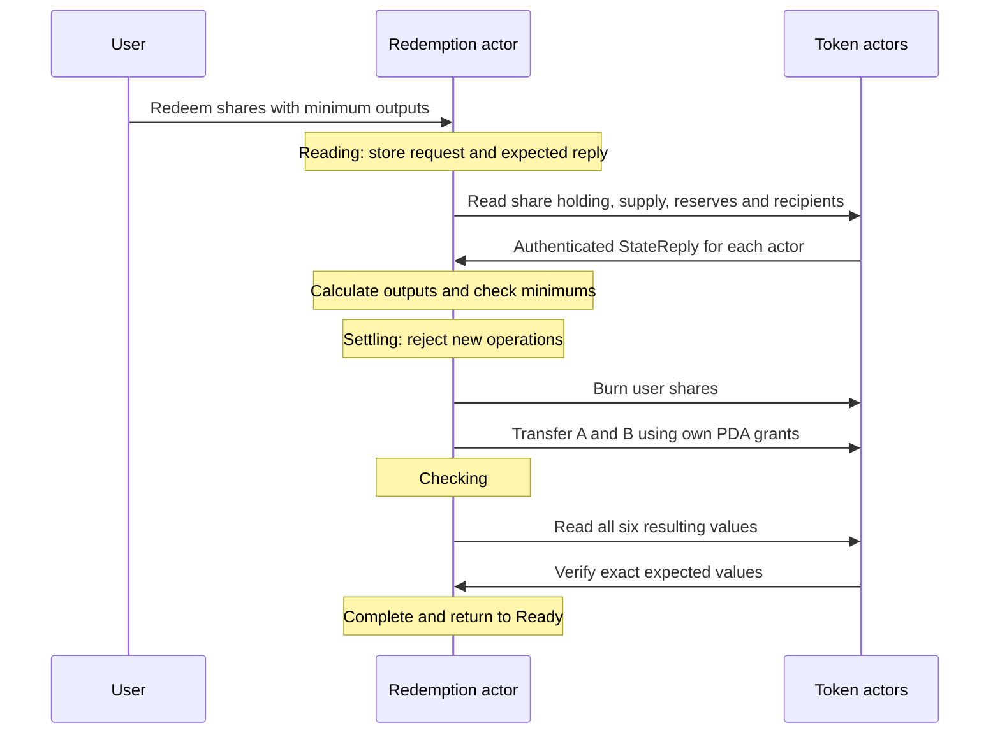

# Proportional redemption of two assets

This separate example keeps the fixed payment examples unchanged. It demonstrates
a decision that requires current state from other actors.

```bash
RISC0_DEV_MODE=1 cargo test -p integration_tests --test token_redemption
```

The program owns two reserve PDAs. A user burns shares and receives a proportional
amount of each asset:

```text
out_a = floor(shares_to_burn * reserve_a / current_share_supply)
out_b = floor(shares_to_burn * reserve_b / current_share_supply)
```

With reserves of 1,000 A and 2,000 B and supply of 1,000 shares, redeeming 100
shares returns 100 A and 200 B. If someone adds 500 A beforehand, the same
redemption returns 150 A and 200 B. If someone burns 100 shares directly through
Token before redemption, original reserves produce 111 A and 222 B. The tests
exercise both changes; the request contains no asserted reserve or supply value.



Each reply must come from the exact account and Token deployment expected for
that step. Holding replies must name the correct asset. State is stored before
issuing each call because the next reply is a new invocation. Here `Reading` is
the pending phase. `Settling` and `Checking` keep the operation active until its
effects and postconditions have completed. These are application states; all
their writes remain staged by the runtime until the transaction succeeds.

The owner configures the assets and initializes the reserve PDAs. The fixture
funds reserves and distributes existing shares in earlier transactions. Each
redemption requires authorization of the user's share holding. Reading its
balance does not authorize burning it. Reserve transfers use grants derived
by the redemption program itself.

The request supplies minimum A and B outputs. The handler rejects insufficient
shares, wrong assets, zero requests, zero rounded outputs, multiplication
overflow, missing authorization and outputs below the minimums. Arithmetic uses
checked `u128`; it rejects an overflowing intermediate product even if a wider
multiply/divide implementation could calculate the final result.

After settlement, authenticated reads verify the user's shares, share supply,
both reserves and both recipient balances. An outer completion check prevents
an unanswered continuation from committing the operation. A test rejects after
all effects and postconditions, then checks that shares, supply, reserves and
recipients return to their pre-redemption state.

## Scope

This is a redemption demonstration, not a complete asset pool. It has no deposit,
share issuance, pricing oracle, fee policy or swap curve. Initial reserves and
share distribution are fixture inputs. Floor rounding leaves dust for remaining
shareholders; the final holder can redeem both reserves completely.

The read sequence relies on the current depth-first execution order and trusted
Token code. It is not a runtime snapshot or a lock over arbitrary external
actors. There is no external policy callback between these reads and settlement.
A production extension that introduces such callbacks must review stale reads
and reentry again. Token code upgrades also affect that trust assumption.

The tests cover public declared actors, including changing reserves and supply,
minimum outputs, wrong assets, insufficient shares, missing authorization, late
rollback, repeated redemption and full final redemption. They do not establish
private/blinded-address support or production proof validity. No performance
comparison is claimed.

A transfer hook alone would not supply the two reserve balances and the current
share supply required by this calculation. The necessary reads and context must
still exist somewhere, even when another interface handles receipt of funds.
